  

# ⚡ Awesome CLI Fuzzy Finder & Terminal Productivity

  
  
  
  
  
  

---

## 🎯 Top CLI Fuzzy Finder & Terminal Productivity Ecosystem

**Curated List of SaaS / Hosted Platforms & Open-Source GitHub Projects**  
*Focused on Interactive CLI Fuzzy Finders, Desktop Command Launchers, Shell History Search, Smart Directory Jumpers & Terminal Multiplexing*  

**Last updated:** November 2026

Welcome to the definitive, SEO-optimized directory of **CLI Fuzzy Finders, Command-Line Search Utilities, and Terminal Productivity Tools**. Whether you are building lightning-fast dev workflows with terminal user interfaces (TUIs), accelerating shell navigation, or searching through millions of files and git commits in milliseconds, this curated repository brings together the best open-source software and SaaS solutions for modern developers, DevOps engineers, Linux rice enthusiasts, and keyboard power users.

Key categories covered:
- 🔍 **Interactive Fuzzy Finders:** Instant regex and fuzzy text stream filtering (`fzf`, `skim`, `television`, `peco`).
- 📁 **Smart Navigation & File Jumpers:** Frecent directory jumping and instant path switching (`zoxide`, `fd`).
- 📜 **Shell History & Intelligent Search:** SQLite-backed shell history and neural command ranking (`atuin`, `mcfly`).
- 🚀 **Desktop & Command Launchers:** Keyboard-first command palettes and window switchers (`rofi`, `Flow Launcher`, `Raycast`, `Alfred`).
- 💻 **Terminal Multiplexing & Pager Tools:** Collaborative sessions, split panes, and syntax previews (`tmux`, `zellij`, `bat`).

Contributions welcome! Open a Pull Request to suggest new utilities. Please ensure descriptions are factual and well-linked.

---

## 📑 Table of Contents

- [📊 Sector Overview & Market Dynamics](#-sector-overview--market-dynamics)
- [☁️ SaaS / Hosted Platforms](#️-saas--hosted-platforms)
- [🌟 Open-Source GitHub Projects](#-open-source-github-projects)
- [📈 Star History](#-star-history)
- [🤝 How to Contribute](#-how-to-contribute)
- [💖 Support & Share](#-support--share)
- [⚠️ Disclaimer](#️-disclaimer)

---

## 📊 Sector Overview & Market Dynamics

The developer productivity and command-line tools market is estimated at approximately **$6.4B to $7.4B globally** (with projections reaching **~$16B by 2031**, growing at a **~16% CAGR**), driven by increasing developer adoption of AI-accelerated workflows and terminal automation. 

The sector remains **moderately fragmented**: while hyperscalers (Microsoft/GitHub, AWS) dominate managed cloud development environments and infrastructure-backed tooling, the client-facing desktop launcher, terminal emulator, and CLI productivity niche is populated by specialized venture-backed innovators (e.g., Warp, Raycast) alongside fiercely independent, community-driven utilities (e.g., Alfred, Everything, and open-source binaries) where a single player does not take all.

---

## ☁️ SaaS / Hosted Platforms

| Platform | Valuation / Company Size | Pricing (Starting Tier) | Free Tier Limits | Description |
| :--- | :--- | :--- | :--- | :--- |
| **[Amazon Q Developer CLI](https://amazon.com)** | ~$2.2 Trillion (Amazon Market Cap) | $19.00 / user / month (Pro Tier) | 50 agentic requests/month, 1,000 lines of code transformation/month, and limited security vulnerability scans (Free forever via AWS Builder ID). | Cloud-backed terminal autocomplete and fuzzy command-palette overlay (incorporating Fig) adding IDE-style completions across hundreds of CLI tools. |
| **[GitHub Codespaces](https://github.com)** | ~$100 Billion+ (GitHub division within Microsoft, parent cap ~$3.1T) | $0.18 / hour (2-core compute) + $0.07 / GB / month storage | 120 core hours/month (equivalent to 60 hours on standard 2-core machines) and 15 GB storage/month on personal accounts (Free forever). | Managed cloud terminal workspaces delivering instant browser-accessible shells pre-configured with fuzzy search, dotfiles sync, and keyboard-centric navigation. |
| **[Warp](https://warp.dev)** | ~$240 Million – $290 Million (Series B, ~$73M–$85M raised) | $20.00 / user / month (Build Tier) | Full access to core terminal features, blocks, and history search forever; excludes bundled Warp AI agent credits (requires Bring Your Own Key / API key for AI use). | Modern GPU-accelerated terminal featuring built-in fuzzy command search, AI command lookup, and cloud-synced team workflows and notebooks. |
| **[Raycast](https://raycast.com)** | ~$100 Million – $250 Million (Series B, ~$48M raised) | $10.00 / month ($8/month billed annually for Pro Tier) | Full core launcher, window management, hotkeys, and community extensions forever; clipboard history limited to 3 months, notes limited to 5, zero AI credits included. | Blazingly fast, extensible macOS (and Windows) command launcher featuring fuzzy search, clipboard history, window management, AI commands, and cloud-synced snippets/settings. |
| **[Alfred](https://alfredapp.com)** | Bootstrapped / Micro-Studio (Running with Crayons Ltd, est. £1M–£5M ARR) | £40.00 one-time single user license (Standard Powerpack; £70 for Mega Supporter lifetime) | Base desktop application search, basic calculations, and web search are free forever; custom workflows, clipboard history, hotkeys, and themes require a paid Powerpack license. | Iconic macOS productivity launcher and workflow automation suite offering instant fuzzy file/app search, custom scripts, hotkeys, and synced preferences. |
| **[Everything](https://voidtools.com)** | Independent / Single Developer (voidtools, donation-funded, $0 valuation) | $0.00 / freeware (Free for personal/commercial desktop use; contact for Everything Server site license) | Full desktop file search, instantaneous NTFS indexing, and regex/fuzzy lookups are 100% free with unlimited local usage forever. | Ultra-fast freeware Windows desktop filename search engine that indexes NTFS/ReFS volumes in seconds for instantaneous fuzzy/regex file lookups. |

---

## 🌟 Open-Source GitHub Projects

Curated open-source terminal productivity and fuzzy-matching tools, strictly sorted by GitHub Stars_Count in descending order:

1. **[junegunn/fzf](https://github.com/junegunn/fzf)**   
   ⚡ Flagship command-line fuzzy finder written in Go with zero dependencies. Includes interactive shell keybindings (`Ctrl-T`, `Ctrl-R`, `Alt-C`), multi-process completion, split-screen previews, and deep Vim/Neovim plugin integration.

2. **[BurntSushi/ripgrep](https://github.com/BurntSushi/ripgrep)**   
   ⚡ Blazingly fast line-oriented search tool written in Rust that recursively searches current directories for regex patterns while respecting `.gitignore`. Routinely paired as the primary search engine for interactive fuzzy finders.

3. **[sharkdp/bat](https://github.com/sharkdp/bat)**   
   ⚡ Modern `cat` clone with syntax highlighting and Git integration written in Rust. Widely used as the preview command engine inside `fzf` and `skim` floating previewers.

4. **[starship/starship](https://github.com/starship/starship)**   
   ⚡ Minimal, blazing-fast, and infinitely customizable cross-shell prompt written in Rust, displaying git statuses, toolchain versions, runtime environments, and shell latency indicators.

5. **[tmux/tmux](https://github.com/tmux/tmux)**   
   ⚡ Veteran terminal multiplexer enabling persistent sessions, split panes, and detached processes. Extensively paired with fuzzy session managers such as `tmux-sessionizer`.

6. **[sharkdp/fd](https://github.com/sharkdp/fd)**   
   ⚡ Simple, fast, and user-friendly alternative to `find` written in Rust. Features colorized terminal output, regex matching, and `.gitignore` awareness by default.

7. **[ajeetdsouza/zoxide](https://github.com/ajeetdsouza/zoxide)**   
   ⚡ Smarter `cd` command written in Rust inspired by `z` and `autojump`. Remembers directories you use most frequently and provides instant fuzzy jumping (`z <query>` and interactive `zi` with `fzf`).

8. **[zellij-org/zellij](https://github.com/zellij-org/zellij)**   
   ⚡ Modern terminal workspace and multiplexer written in Rust featuring built-in layout engines, webassembly plugin support, and intuitive keyboard navigation.

9. **[atuinsh/atuin](https://github.com/atuinsh/atuin)**   
   ⚡ Magical shell history replacement written in Rust. Replaces default shell history with an SQLite database, full-screen interactive TUI fuzzy search, directory contexts, and optional end-to-end encrypted sync.

10. **[davatorium/rofi](https://github.com/davatorium/rofi)**   
    ⚡ Versatile window switcher, application launcher, and `dmenu` replacement for X11 and Wayland desktops with dynamic scripting modes and customizable themes.

11. **[Flow-Launcher/Flow.Launcher](https://github.com/Flow-Launcher/Flow.Launcher)**   
    ⚡ Quick-launcher and fuzzy search command palette for Windows. Seamlessly integrates with Everything search and community plugins for Python, C#, and web lookups.

12. **[vicinaehq/vicinae](https://github.com/vicinaehq/vicinae)**   
    ⚡ Fast, extensible native desktop launcher for Linux and cross-platform desktop environments inspired by Raycast and Alfred with comprehensive extensions.

13. **[peco/peco](https://github.com/peco/peco)**   
    ⚡ Simplistic interactive filtering tool written in Go for parsing log streams, process lists, and piped shell commands with incremental fuzzy matching.

14. **[cantino/mcfly](https://github.com/cantino/mcfly)**   
    ⚡ Neural network-powered shell history search written in Rust. Prioritizes commands based on working directory, recent context, and command exit status.

15. **[skim-rs/skim](https://github.com/skim-rs/skim)**   
    ⚡ Fuzzy finder written in Rust that functions as both a standalone CLI binary and an embeddable Rust crate library for terminal user interfaces.

16. **[alexpasmantier/television](https://github.com/alexpasmantier/television)**   
    ⚡ Blazingly fast, multi-channel general-purpose fuzzy finder TUI written in Rust with built-in preview handlers for files, Git, Docker, and environment variables.

17. **[Ulauncher/Ulauncher](https://github.com/Ulauncher/Ulauncher)**   
    ⚡ Fast application launcher for Linux written in Python using GTK+, featuring fuzzy app search, custom color themes, and dozens of community extensions.

18. **[jhawthorn/fzy](https://github.com/jhawthorn/fzy)**   
    ⚡ Lightweight terminal fuzzy text selector written in C with an optimized scoring heuristic specifically tuned for file paths and codebases.

19. **[helix-editor/nucleo](https://github.com/helix-editor/nucleo)**   
    ⚡ High-performance multi-threaded parallel fuzzy matcher crate written in Rust, engineered specifically to power the Helix modal text editor picker and command palettes.

20. **[mptre/pick](https://github.com/mptre/pick)**   
    ⚡ Minimalist, POSIX-compliant fuzzy selection utility written in C designed to read input lines from `stdin` and print chosen selections cleanly to `stdout`.

21. **[suckless / dmenu](https://suckless.org)**  
    ⚡ The classic suckless dynamic menu for X11, providing lightweight keyboard-driven selection for custom scripts and desktop environments.

---

## 📈 Star History

---

## 🤝 How to Contribute

We welcome contributions from the community! Here is how you can help expand this productivity directory:

1. 🍴 **Fork the repository** on GitHub.
2. 🌿 **Create a new branch** (`git checkout -b feature/add-new-tool`).
3. 📝 **Add or update an entry** in `README.md` following the existing format (include repository link, Stars_Badge, and clear 1–2 sentence description).
4. 🚀 **Commit your changes** (`git commit -m "feat: add awesome-tool"`).
5. 📬 **Submit a Pull Request** with a brief summary of why the tool belongs in this list.

---

## 💖 Support & Share

A huge **thank you** for checking out this repository! If this curated list helped supercharge your terminal workflow, saved you time searching for tools, or introduced you to your new favorite utility, please consider supporting the project:

- ⭐ **Star this repository** to show your appreciation and help others find it!
- 🍴 **Fork & Share** it with your engineering team, friends, and developer communities on [X/Twitter](https://twitter.com), [LinkedIn](https://linkedin.com), and [Reddit](https://reddit.com).
- ☕ **Buy me a coffee & Sponsor:** If you'd like to back ongoing open-source maintenance, consider sponsoring via the official **[GitHub Sponsor Dashboard](https://github.com/sponsors/ishandutta2007)**. Sponsorship tiers include profile recognition, README badges, and prioritized reviews!

---

## ⚠️ Disclaimer

- This is an independent, **community-curated** list for educational and developer productivity purposes.
- Note that `Everything` (Voidtools) is closed-source freeware rather than open-source, and is listed in the hosted/desktop platforms section.
- Be mindful when piping sensitive environment variables, SSH keys, or confidential shell histories into interactive terminal pickers or cloud-synced history daemons without proper redaction filters.

---

  <b>Built with ❤️ for terminal power users, software engineers, DevOps pros, and open-source enthusiasts worldwide.</b> 
  <i>Let's make command-line workflows faster, smarter, and completely keyboard-driven!</i>

